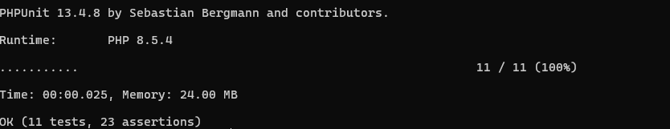

# API de Controle Financeiro

Nome: Davi Salvador Schubert  
Curso: Informática para Internet  
UC: Desenvolver Serviços Web

Esse projeto individual se baseia em uma API de controle financeiro, capaz de cadastrar, pesquisar, atualizar e deletar categorias e lançamentos financeiros, além de consultar o saldo e gerar resumos de movimentações por período.

Foram utilizadas as tecnologias:

- PHP
- Slim Framework
- Composer
- JSON
- PHPUnit

## Instalação

Para clonar este projeto, abra o Windows PowerShell e digite:

```bash
git clone https://github.com/OTalDavi/Avaliacao.git
```

Entre na pasta do projeto e instale as dependências:

```bash
composer install
```

Para instalar o PHPUnit como dependência de desenvolvimento:

```bash
composer require --dev phpunit/phpunit
```

Para executar o projeto:

```bash
php -S localhost:8080 -t public
```

## Endpoints

### GET /status

URL: `localhost:8080/status`

Objetivo: verificar se a API está funcionando corretamente.

Exemplo de requisição:

```http
GET /status
```

Exemplo de resposta:

```json
{
  "status": "ok"
}
```

### GET /categorias

URL: `localhost:8080/categorias`

Objetivo: pesquisar todas as categorias cadastradas.

Exemplo de resposta:

```json
[
  {
    "id": 1,
    "nome": "Alimentação",
    "tipo": "despesa"
  },
  {
    "id": 2,
    "nome": "Salário",
    "tipo": "receita"
  }
]
```

### GET /categorias/1

URL: `localhost:8080/categorias/1`

Objetivo: pesquisar a categoria cadastrada com o ID 1.

Exemplo de resposta:

```json
{
  "id": 1,
  "nome": "Alimentação",
  "tipo": "despesa"
}
```

### POST /categorias

URL: `localhost:8080/categorias`

Objetivo: cadastrar uma nova categoria.

Exemplo de requisição:

```json
{
  "nome": "Pets",
  "tipo": "despesa"
}
```

Exemplo de resposta:

```json
{
  "id": 3,
  "nome": "Pets",
  "tipo": "despesa"
}
```

### PUT /categorias/1

URL: `localhost:8080/categorias/1`

Objetivo: atualizar a categoria cadastrada com o ID 1.

Exemplo de requisição:

```json
{
  "nome": "Mercado",
  "tipo": "despesa"
}
```

Exemplo de resposta:

```json
{
  "id": 1,
  "nome": "Mercado",
  "tipo": "despesa"
}
```

### DELETE /categorias/1

URL: `localhost:8080/categorias/1`

Objetivo: deletar a categoria cadastrada com o ID 1, desde que não existam lançamentos vinculados a ela.

Exemplo de requisição:

```http
DELETE /categorias/1
```

Exemplo de resposta:

```json
{
  "mensagem": "Categoria excluída com sucesso"
}
```

### GET /lancamentos

URL: `localhost:8080/lancamentos`

Objetivo: pesquisar todos os lançamentos financeiros cadastrados.

Exemplo de resposta:

```json
[
  {
    "id": 1,
    "descricao": "Ração",
    "valor": 85.50,
    "data": "2024-06-20",
    "tipo": "despesa",
    "categoria_id": 1
  },
  {
    "id": 2,
    "descricao": "Salário",
    "valor": 2500.00,
    "data": "2024-06-05",
    "tipo": "receita",
    "categoria_id": 2
  }
]
```

### GET /lancamentos/1

URL: `localhost:8080/lancamentos/1`

Objetivo: pesquisar o lançamento cadastrado com o ID 1.

Exemplo de resposta:

```json
{
  "id": 1,
  "descricao": "Ração",
  "valor": 85.50,
  "data": "2024-06-20",
  "tipo": "despesa",
  "categoria_id": 1
}
```

### POST /lancamentos

URL: `localhost:8080/lancamentos`

Objetivo: cadastrar um novo lançamento financeiro.

Exemplo de requisição:

```json
{
  "descricao": "Ração",
  "valor": 85.50,
  "data": "2024-06-20",
  "tipo": "despesa",
  "categoria_id": 1
}
```

Exemplo de resposta:

```json
{
  "id": 3,
  "descricao": "Ração",
  "valor": 85.50,
  "data": "2024-06-20",
  "tipo": "despesa",
  "categoria_id": 1
}
```

### PUT /lancamentos/1

URL: `localhost:8080/lancamentos/1`

Objetivo: atualizar o lançamento cadastrado com o ID 1.

Exemplo de requisição:

```json
{
  "descricao": "Ração para cachorro",
  "valor": 95.00,
  "data": "2024-06-20",
  "tipo": "despesa",
  "categoria_id": 1
}
```

Exemplo de resposta:

```json
{
  "id": 1,
  "descricao": "Ração para cachorro",
  "valor": 95.00,
  "data": "2024-06-20",
  "tipo": "despesa",
  "categoria_id": 1
}
```

### DELETE /lancamentos/1

URL: `localhost:8080/lancamentos/1`

Objetivo: deletar o lançamento cadastrado com o ID 1.

Exemplo de requisição:

```http
DELETE /lancamentos/1
```

Exemplo de resposta:

```json
{
  "mensagem": "Lançamento excluído com sucesso"
}
```

### GET /resumo/saldo

URL: `localhost:8080/resumo/saldo`

Objetivo: consultar o total de receitas, despesas e o saldo atual.

Exemplo de requisição:

```http
GET /resumo/saldo
```

Exemplo de resposta:

```json
{
  "receitas": 2500.00,
  "despesas": 85.50,
  "saldo": 2414.50
}
```

### GET /resumo/periodo

URL: `localhost:8080/resumo/periodo?data_inicio=2024-06-01&data_fim=2024-06-30`

Objetivo: consultar o resumo financeiro de um período específico.

Exemplo de requisição:

```http
GET /resumo/periodo?data_inicio=2024-06-01&data_fim=2024-06-30
```

Exemplo de resposta:

```json
{
  "data_inicio": "2024-06-01",
  "data_fim": "2024-06-30",
  "receitas": 2500.00,
  "despesas": 85.50,
  "saldo": 2414.50
}
```

## Filtros de lançamentos

Também é possível pesquisar lançamentos utilizando filtros por data, categoria e tipo.

Exemplo de requisição:

```http
GET /lancamentos?data_inicio=2024-06-01&data_fim=2024-06-30&tipo=despesa&categoria_id=1
```

Objetivo: pesquisar lançamentos de despesas da categoria 1 realizados entre 01/06/2024 e 30/06/2024.

## Regras aplicadas

- O valor do lançamento precisa ser maior que zero.
- A data deve existir e estar no formato AAAA-MM-DD.
- O tipo deve ser receita ou despesa.
- A categoria precisa existir e ter o mesmo tipo do lançamento.
- Não é permitido cadastrar duas categorias com o mesmo nome.
- Não é permitido excluir categorias que possuam lançamentos vinculados.
- Não é permitido alterar o tipo de uma categoria quando isso tornar lançamentos existentes incompatíveis.

## Testes automatizados

Para executar os testes do projeto, entre no terminal e digite:

```bash
vendor/bin/phpunit
```
